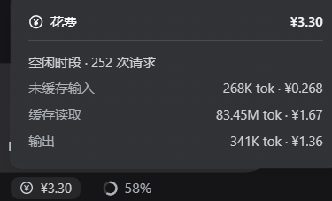

# dsh-plugin-session-cost

A [DeepSeek Harness](https://github.com/deepseek-ai/deepseek-harness) plugin that shows what the current
session has cost so far, split by DeepSeek's peak and off-peak rate windows.



**English** | [中文](README.zh.md)

## What it shows

A pill in the composer dock, beside the shipped token-usage pill:

```
   [shipped] 11 turns 191 steps · 226 tok/s   51.5M tok · 99.5% cached        (¥) ¥2.75
```

Click it for the breakdown. A session that stayed inside one window shows a single block:

```
(¥) Cost                                          ¥1.09
───────────────────────────────────────────────────────
Off-peak · 110 requests
Uncached input                          187K tok · ¥0.187
Cache read                            20.77M tok · ¥0.415
Output                                  121K tok · ¥0.482
```

A session spanning both windows splits into two blocks, each with its own subtotal:

```
(¥) Cost                                          ¥3.30
───────────────────────────────────────────────────────
Peak · 3 requests
Uncached input                         1.00M tok · ¥2.00
Output                                  100K tok · ¥0.800
Subtotal                                          ¥2.80
Off-peak · 7 requests
Cache read                             5.00M tok · ¥0.100
Output                                  100K tok · ¥0.400
Subtotal                                          ¥0.500
```

The figure is the **whole session**, not the loaded window: paging, compaction, and
resuming a session do not change it, and a retried model request is not billed twice.

## Install

```powershell
git clone https://github.com/hoebeed/dsh-plugin-session-cost
cd dsh-plugin-session-cost
powershell -NoProfile -ExecutionPolicy Bypass -File .\install.ps1
```

The script does two things: copies the package to `<profile>\plugins\session-cost\`, and
appends the mount entry to `<profile>\cordis.patch.yml` (skipped when it is already there).
Then **refresh the DSH page (Ctrl+R)**.

The profile directory is resolved in this order: the `-ProfileDir` argument, then
`$env:DSH_PROFILE_DIR`, then `~\.dsh\profiles\desktop`.

`-ExecutionPolicy Bypass` is needed because Windows blocks unsigned `.ps1` files by
default. On a machine whose execution policy already allows local scripts, `.\install.ps1`
works as-is. On macOS or Linux, do the same two steps by hand under PowerShell 7.

## Configure

Edit the profile's `cordis.patch.yml` and save — the patch layer is watched, so no restart
is needed. Refresh the page afterwards so the browser picks up the new rates.

```yaml
- insert:
    - id: session-cost-v2
      name: ./plugins/session-cost/host.js
      config:
        currency: "¥"     # display symbol
        per: 1000000      # the four rates below are per this many tokens
        input: 1          # uncached input     <- off-peak rate
        cacheRead: 0.02   # cache read         <- off-peak rate
        cacheWrite: 0     # cache write (DeepSeek does not bill this separately)
        output: 4         # output             <- off-peak rate
        holidays: []      # Beijing dates, e.g. ["2026-10-01", "2026-10-02"]
        # peak:           # omit to default to off-peak x 2
        #   input: 2
        #   cacheRead: 0.04
        #   cacheWrite: 0
        #   output: 8
```

The built-in defaults are **DeepSeek `deepseek-flash` off-peak list prices** in CNY per
million tokens, taken from the official pricing page on 2026-10-15:

| | Off-peak | Peak |
|---|---|---|
| Input (cache hit) | ¥0.02 | ¥0.04 |
| Input (cache miss) | ¥1 | ¥2 |
| Output | ¥4 | ¥8 |

**Check them against your own bill.** A third-party gateway does not bill these numbers,
and this table covers only `deepseek-flash`.

## Limitations

- **Holidays are yours to fill in.** `holidays` defaults to empty. China's public holidays
  are announced yearly and cannot be derived, so top the list up each year. Weekends that
  are worked as make-up days stay off-peak: the published rule only looks at Monday-Friday
  plus the holiday list.
- **One rate table, not one per model.** Switching models mid-session is not detected; every
  token is priced with the same rates.
- **Reasoning tokens are not added on top.** `reasoningTokens` is a subset of what output is
  billed for, so adding it would double-count.
- **An estimate, not an invoice.** Token cost only — no minimum spend, tiered pricing,
  currency conversion, or granted credit.
- **The peak window is fixed** at Beijing time Monday-Friday 09:00-12:00 and 14:00-18:00.

The design behind the numbers, and the DSH internals this plugin had to work around, are in
[docs/IMPLEMENTATION.md](docs/IMPLEMENTATION.md).

## Development

```powershell
node .\check.mjs         # 43 assertions on the client half, against ./client.js
node .\check-host.mjs "<profile>\plugins\session-cost\host.js"   # 33 assertions on the host half
```

`check.mjs` needs nothing but Node: it renders the client half through a small React
stand-in that covers exactly the API surface the component uses.

`check-host.mjs` imports the host half, which resolves `@deepseek-ai/schemastery` and `zod`
from its own location — both are supplied by DeepSeek Harness. Point it at an installed copy
(the normal case), or install those two packages first. Run it with no argument and it says
so instead of failing silently.

## License

MIT © 2026 hoebeed
